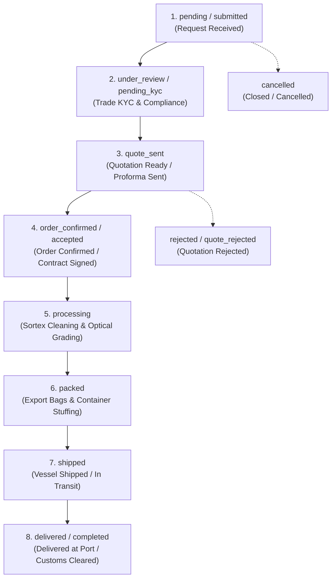

# INDKAN HarvestLink - Backend REST API Engine

A robust B2B Agricultural Commodity Export REST API backend built with **Python 3**, **Flask**, and **MySQL 8.0 Enterprise Stored Procedures**. Powers the international trade platform for pulses, lentils, and premium spices with buyer enquiry workflows, multi-stage shipment tracking, and administrative trade management.

---

## 📋 Table of Contents
1. [Tech Stack & Architecture](#-tech-stack--architecture)
2. [Repository Structure & File Paths](#-repository-structure--file-paths)
3. [Prerequisites](#-prerequisites)
4. [Step-by-Step Local Setup](#-step-by-step-local-setup)
5. [Environment Configuration (.env)](#-environment-configuration-env)
6. [Database Schema & Stored Procedures Import](#-database-schema--stored-procedures-import)
7. [Admin Authentication & Security Credentials](#-admin-authentication--security-credentials)
8. [Running the Application](#-running-the-application)
9. [Trade Status & Shipment Workflow](#-trade-status--shipment-workflow)
10. [API Documentation](#-api-documentation)
11. [Cloud Deployment Guide (Render, Railway & Vercel)](#-cloud-deployment-guide)

---

## 🛠 Tech Stack & Architecture

- **Runtime & Framework**: Python 3.10+, Flask 3.x
- **Database Engine**: MySQL 8.0+ with relational foreign keys, cascade rules, and optimized stored procedures (`sp_*`)
- **Connector**: `mysql-connector-python`
- **Security & Cryptography**: Werkzeug Scrypt password hashing (`generate_password_hash` / `check_password_hash`), custom HMAC-SHA256 JWT tokens
- **CORS Handling**: `Flask-CORS` for cross-origin requests from Vite / React frontend
- **Production WSGI Server**: `gunicorn`
- **PDF Export Architecture**: Client-side high-fidelity vector rendering via `jspdf` & `jspdf-autotable` to keep the backend API lightweight, stateless, and cloud-scalable.

---

## 📁 Repository Structure & File Paths

Ensure your repository preserves the following structure. Note that Linux environments (e.g., Render, Railway, Ubuntu) are case-sensitive:

```text
Indkan_HarvestLink/
├── Indkan_Backend/
│   ├── Database/
│   │   └── database.sql          <-- Complete schema, stored procedures & seed data
│   ├── controllers/
│   │   ├── admin_controller.py   <-- Admin auth, product CRUD, enquiry status workflow
│   │   ├── category_controller.py<-- Category management
│   │   ├── enquiry_controller.py <-- Buyer RFQ submission & PIN tracking
│   │   └── product_controller.py <-- Product catalogue & details
│   ├── uploads/                  <-- Uploaded commodity media
│   ├── .env                      <-- Local secrets (git-ignored)
│   ├── .env.example              <-- Configuration template
│   ├── .gitignore                <-- Excludes venv/, .env, __pycache__/
│   ├── app.py                    <-- Flask entrypoint & route registration
│   ├── dbConnection.py           <-- MySQL connector pool
│   ├── Procfile                  <-- web: gunicorn app:app (for cloud hosts)
│   ├── README.md                 <-- This documentation
│   └── requirements.txt          <-- Python dependencies
└── Indkan_Frontend/              <-- React + Vite + TypeScript frontend
```

---

## 📦 Prerequisites

Before starting, verify the following tools on your machine:
- **Python**: Version 3.10 or higher (`python --version`)
- **pip**: Python package installer (`pip --version`)
- **MySQL Server**: MySQL 8.0 or compatible MariaDB server (`mysql --version`)
- **Git**: For version control (`git --version`)

---

## 🚀 Step-by-Step Local Setup

### Step 1: Navigate to Backend Directory
```bash
cd Indkan_Backend
```

### Step 2: Create a Python Virtual Environment
- **Windows (PowerShell or CMD)**:
  ```powershell
  python -m venv venv
  ```
- **Linux / macOS**:
  ```bash
  python3 -m venv venv
  ```

### Step 3: Activate the Virtual Environment
- **Windows (PowerShell)**:
  ```powershell
  .\venv\Scripts\Activate.ps1
  ```
  *(If execution is restricted, run: `Set-ExecutionPolicy -Scope Process -ExecutionPolicy Bypass`)*

- **Windows (Command Prompt)**:
  ```cmd
  venv\Scripts\activate.bat
  ```

- **Linux / macOS**:
  ```bash
  source venv/bin/activate
  ```

### Step 4: Install Dependencies
```bash
pip install -r requirements.txt
```

---

## ⚙️ Environment Configuration (.env)

1. Copy the provided template `.env.example` to `.env`:
   - **Windows**:
     ```powershell
     copy .env.example .env
     ```
   - **Linux / macOS**:
     ```bash
     cp .env.example .env
     ```

2. Open `.env` and configure your credentials:
   ```env
   # Application Server Port
   PORT=5001

   # Flask Environment (development / production)
   FLASK_ENV=development

   # MySQL Database Connection Settings
   DB_HOST=localhost
   DB_PORT=3306
   DB_NAME=indkan_db
   DB_USER=root
   DB_PASSWORD=your_mysql_password_here

   # JWT / HMAC Security Secret Key
   # Replace with a cryptographically secure random string in production
   SECRET_KEY=replace_with_a_long_random_secret
   ```

> ⚠️ **Security Notice**: Never commit your active `.env` file containing real database passwords or secret keys to Git. The `.gitignore` file automatically excludes `.env`.

---

## 🗄 Database Schema & Stored Procedures Import

The complete schema, foreign key relations, audit history table, stored procedures, and initial seed data are located in `Database/database.sql`.

### Method A: Using MySQL Command Line (CLI)
1. Log in to MySQL:
   ```bash
   mysql -u root -p
   ```
2. Run the script:
   ```sql
   source Database/database.sql;
   ```
   *(Or on Windows full path: `source e:/Indkan_HarvestLink/Indkan_Backend/Database/database.sql;`)*

### Method B: Using MySQL Workbench / phpMyAdmin / Cloud Console
1. Open MySQL Workbench or phpMyAdmin.
2. Open and execute `Database/database.sql`.
3. It will automatically:
   - Create the `indkan_db` database (`utf8mb4`).
   - Create tables: `users`, `categories`, `products`, `enquiries`, `enquiry_items`, `enquiry_status_history`.
   - Create all stored procedures:
     - `sp_get_categories`
     - `sp_get_products`
     - `sp_get_product_by_id`
     - `sp_get_product_image`
     - `sp_save_enquiry`
     - `sp_save_enquiry_item`
   - Insert default trade categories and initial export commodities.
   - Insert the default evaluation Super Admin user.

---

## 🔐 Admin Authentication & Security Credentials

### Local Demo / Evaluation Credentials
For initial local evaluation and testing the Admin Panel, the seed script creates a default administrator:

| Field | Local Demo Value | Production Note |
| :--- | :--- | :--- |
| **Email** | `admin@indkan.com` | Can be customized in `users` table |
| **Password** | `admin123` | **Must be changed immediately before public deployment** |
| **Role** | `admin` (INDKAN Super Admin) | Full control over trade inventory & RFQ stages |
| **Access URL** | `http://localhost:5175/admin` | Protected by JWT token verification |

> 🔒 **Production Hardening Guidelines**:
> 1. Passwords are encrypted using Werkzeug's `scrypt` hashing algorithm (`scrypt:32768:8:1$...`).
> 2. Immediately upon logging in to a production environment, change the password via the Admin Profile modal or call `POST /api/admin/change-password`.
> 3. Alternatively, create a dedicated new admin user and set `is_active = 0` on the demo account.

---

## ⚡ Running the Application

### Development Mode (Local Testing)
With your virtual environment activated:
```bash
python app.py
```
Output:
```
Database connected successfully!
Starting INDKAN HarvestLink API Server on http://0.0.0.0:5001 (debug=True)
 * Running on all addresses (0.0.0.0)
 * Running on http://127.0.0.1:5001
```

### Production Mode (Using Gunicorn)
On Linux/Cloud hosting (Render, Railway, Ubuntu VPS):
```bash
gunicorn app:app --bind 0.0.0.0:5001 --workers 2 --timeout 120
```

### Verify Server Health
- Categories: `http://127.0.0.1:5001/api/categories`
- Products: `http://127.0.0.1:5001/api/products`

---

## 🔄 Trade Status & Shipment Workflow

The backend implements a dual-tier status model to support both high-level database categorization and the granular multi-stage international export lifecycle.



### Detailed Status Definitions (`verification_status`)

| Status Value | User Facing Stage Label | Step | Description |
| :--- | :--- | :---: | :--- |
| `pending` / `submitted` | **Request Received** | 1 | Buyer submitted RFQ via portal with commodity specs and quantities. |
| `under_review` / `pending_kyc` | **Under Review (Trade KYC)** | 2 | Trade desk verifying import legitimacy, buyer tax ID, and destination port. |
| `quote_sent` | **Quotation Ready** | 3 | Formal export proforma quotation (FOB/CIF) issued to buyer. |
| `order_confirmed` / `accepted`| **Order Confirmed** | 4 | Quotation accepted, commercial trade contract executed. |
| `processing` | **Processing & Sortex Cleaning** | 5 | Commodities undergoing optical sorting, purity grading, and moisture check. |
| `packed` | **Packed in Export Bags** | 6 | Packed into specified packaging (PP bags, jute, jumbo liners) with APEDA/Phyto tags. |
| `shipped` | **Vessel Shipped (In Transit)** | 7 | Bill of Lading (B/L) issued; cargo onboard container vessel in international transit. |
| `delivered` / `completed` | **Delivered at Port / Closed** | 8 | Cargo arrived at destination port, cleared customs, trade transaction finalized. |
| `rejected` / `quote_rejected` | **Quotation Rejected** | 0 | Buyer declined price or specs; RFQ closed. |
| `cancelled` | **Closed / Cancelled** | 0 | Enquiry cancelled due to stock limits or buyer request. |

### High-Level DB Enum Status (`status`)
Maintained for backwards-compatibility and legacy queries:
- `pending`: Covers `pending`, `submitted`, `under_review`
- `contacted`: Covers `quote_sent`, `order_confirmed`, `processing`, `packed`, `shipped`
- `completed`: Covers `delivered`, `completed`
- `cancelled`: Covers `rejected`, `quote_rejected`, `cancelled`

> 📝 **Audit Trail**: Every update via `PATCH /api/admin/enquiries/<id>/status` records the previous status, new status, timestamp, admin operator name, and custom audit note into `enquiry_status_history`.

---

## 📡 API Documentation

### Public Endpoints (Buyer Portal)

| Method | Endpoint | Description |
| :--- | :--- | :--- |
| `GET` | `/api/categories` | Retrieve all active commodity categories |
| `GET` | `/api/products` | Retrieve active products (supports `?category_id=N`) |
| `GET` | `/api/products/<id>` | Fetch detailed product specifications, MOQ, and packaging options |
| `POST` | `/api/enquiries` | Submit B2B export RFQ with items, packaging, and delivery port |
| `POST` | `/api/enquiries/track-by-pin` | Track live enquiry status using Reference ID & Secret PIN |
| `POST` | `/api/enquiries/change-pin` | Change tracking security PIN |
| `GET` | `/uploads/<filename>` | Serve uploaded product specification images |

### Admin Endpoints (Requires `Authorization: Bearer <token>`)

| Method | Endpoint | Description |
| :--- | :--- | :--- |
| `POST` | `/api/admin/login` | Authenticate admin credentials and issue HMAC-SHA256 JWT token |
| `GET` | `/api/admin/me` | Validate admin session profile |
| `POST` | `/api/admin/change-password` | Update administrator account password |
| `GET` | `/api/admin/stats` | KPI counters (Total Enquiries, Pending KYC, Active Catalogue, In Stock) |
| `GET` | `/api/admin/products` | List all inventory with stock quantity, units, and availability |
| `POST` | `/api/admin/products` | Add new agri commodity to catalogue |
| `PUT` | `/api/admin/products/<id>` | Update product details |
| `PATCH` | `/api/admin/products/<id>/stock`| Update stock status (`in_stock`, `low_stock`, `out_of_stock`, `on_request`) |
| `PATCH` | `/api/admin/products/<id>/toggle-status`| Toggle active visibility on storefront |
| `DELETE`| `/api/admin/products/<id>` | Remove product listing |
| `POST` | `/api/admin/upload-image` | Upload product imagery |
| `GET` | `/api/admin/categories` | Admin category management list |
| `POST` | `/api/admin/categories` | Create new category |
| `PUT` | `/api/admin/categories/<id>`| Edit existing category |
| `DELETE`| `/api/admin/categories/<id>`| Delete category |
| `GET` | `/api/admin/enquiries` | List all submitted buyer RFQs with items and current stage |
| `GET` | `/api/admin/enquiries/<id>` | Get single enquiry full audit trail and history logs |
| `PATCH` | `/api/admin/enquiries/<id>/status`| Advance trade workflow stage with audit note |
| `POST` | `/api/admin/enquiries/<id>/notes` | Save internal admin/customs audit notes |

---

## ☁️ Cloud Deployment Guide

### 1. Database (Cloud MySQL)
Host your MySQL database on a cloud tier:
- **TiDB Cloud Serverless** (Recommended, generous free tier, 100% MySQL compatible)
- **Aiven for MySQL**
- **Railway MySQL**

**Steps:**
1. Create a MySQL cluster in your cloud dashboard.
2. Note connection details: `Host`, `Port`, `Database Name`, `User`, `Password`.
3. Open the cloud SQL console or connect via MySQL Workbench and execute `Database/database.sql`.

### 2. Backend (Render / Railway)
- **Hosting**: [Render](https://render.com) or [Railway](https://railway.app)
- **Root Directory**: `Indkan_Backend` *(if deploying from a monorepo; leave empty `./` if repository root)*
- **Build Command**: `pip install -r requirements.txt`
- **Start Command**: `gunicorn app:app` *(App definition verified in `app.py`)*
- **Environment Variables**:
  - `PORT`: (Auto-assigned by cloud host)
  - `DB_HOST`: Your cloud database host
  - `DB_PORT`: `3306` (or provided port)
  - `DB_NAME`: `indkan_db`
  - `DB_USER`: Your cloud database username
  - `DB_PASSWORD`: Your cloud database password
  - `SECRET_KEY`: A cryptographically secure random string

### 3. Frontend (Vercel)
- **Hosting**: [Vercel](https://vercel.com)
- **Root Directory**: `Indkan_Frontend`
- **Framework Preset**: `Vite`
- **Build Command**: `npm run build`
- **Output Directory**: `dist`
- **Environment Variables**:
  - `VITE_API_BASE_URL`: `https://your-backend-app.onrender.com` (Your deployed Render/Railway backend URL)

### 4. CORS & Media Verification
- `CORS(app)` is configured in `app.py` to allow cross-origin requests from the Vercel domain.
- Product images uploaded to `/uploads` are served via `GET /uploads/<filename>` with standard static directory fallbacks.
